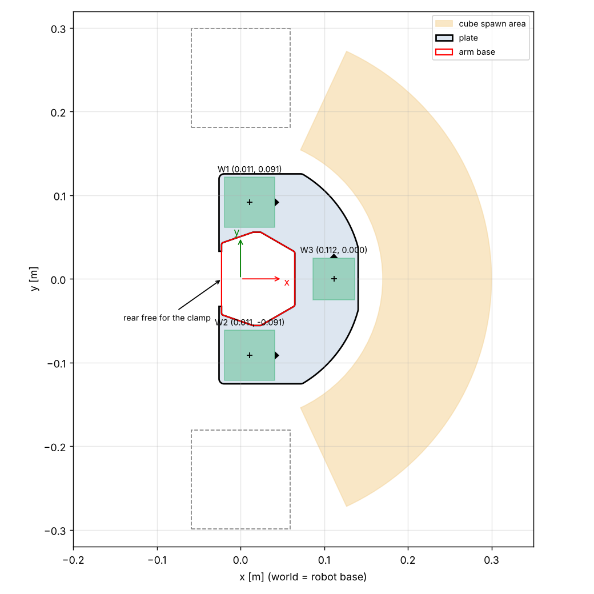

# Base plate

Plate around the SO-101 base that carries the three QR codes. The Quest and the RealSense both use them to find the robot base frame, so the plate must not move relative to the arm. A 12 mm high collar hugs the base on all sides, only the middle of the rear face is open for the table clamp.



## Files

| File | What it is |
|---|---|
| `make_baseplate.py` | Generates everything below from the base mesh, the layout constants and the cube spawn area in `config/scene.yaml` |
| `../../sim/model/assets/baseplate.stl` | The plate, one piece, for printing and for the sim |
| `out/baseplate.dxf` | Same outline for a laser cutter, in mm (`CUT` / `ENGRAVE` layers) |
| `out/markers.pdf` | QR codes at 1:1 for printing on Letter |
| `out/baseplate_preview.png` | Top view with spawn area and bins |
| `../../config/world_markers.yaml` | Marker centers and code corners in the robot base frame, read by the sim, the camera calibration and the Quest app |

```
pip install -e ".[baseplate]"
python -m hardware.baseplate.make_baseplate
```

## Layout

- World frame = robot base, x towards the workspace, z up.
- W1 and W2: 60 mm QR codes left and right of the base. W3: 50 mm in front of the base, 22 mm away so the shoulder motor doesn't hide it from the camera.
- Payloads `so101-W1..3`. Each code sits in a 0.6 mm recess with a small triangle that marks the top edge of the code. The corner order in the yaml depends on that, so glue the codes the right way round.
- Plate 4 mm, about 166 x 251 mm, fits a 256 mm bed in one piece.
- The cutout is the base footprint plus 0.3 mm clearance. Around it a 3 mm wide collar goes up to 12 mm above the table, the base walls are straight up to about 15 mm. The collar also wraps the two rear corners, so the base is held in x, y and yaw from both sides. Only the middle 66 mm of the rear face is open.
- The base stands on the table, so the table top stays at z = 0. Code surface is at z = 3.4 mm.
- The front edge follows the cube spawn area (min radius 0.17 m in `scene.yaml`).

## Printing

- PLA or PETG, 0.2 mm layers, 3 to 4 walls, 20 % infill, flat side down, brim against warping.
- Check the base fit on the first print. If it's too tight, raise `cutout_clearance` in the script (0.3 mm now), if it has play, lower it.
- Print `markers.pdf` at 100 % and check the 100 mm bar. Matte paper, cut on the grey line, glue into the recesses with the top edge towards the triangle.

## Mounting

1. Place the plate at the table edge, the collar behind the base is only 3 mm.
2. Lift the arm slightly and set it into the collar (or put the plate down first and the arm into it, then clamp). The collar holds the plate in x, y and yaw.
3. Clamp the base at the open rear and tape the plate down so it can't lift.

If the plate or a code moves, the calibration is wrong. Change the layout only in the script and rerun it.
